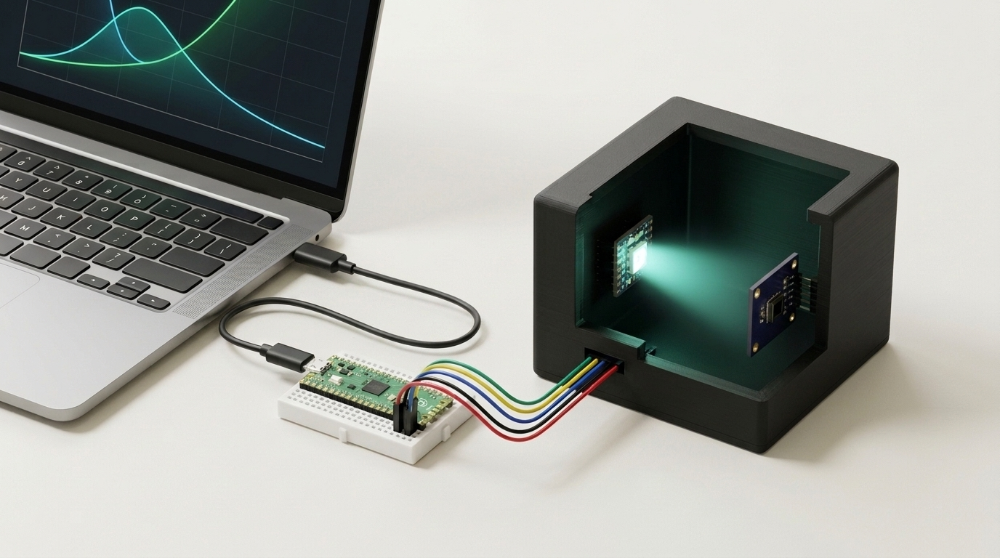

# Pocket SDL Classroom

用一块 **Raspberry Pi Pico H (RP2040)**、一颗 **RGB LED (WS2812B)** 和一颗 **8 通道光谱传感器 (AS7341)**，在桌面暗盒里搭起一台「口袋自主实验室（Pocket Self-Driving Lab）」。

在浏览器工作台里，你可以亲手接线、校验传感器稳定性、与随机搜索和贝叶斯优化（AI）同台比拼调色配方，并通过复测、多种子统计和色片对照理解实验数据为什么可靠——**没有硬件也可以用仿真模式完整体验全部流程**。



---

## 快速开始

### 方式一：使用老师分发的离线包（推荐课堂使用）

如果你拿到了对应平台的离线 ZIP（`Windows-x64` / `Mac-Apple` / `Mac-Intel`），**无需安装 Python、Git 或联网下载依赖**。

1. 将 ZIP **完整解压**到本地文件夹（不要在压缩包里直接双击）。
2. 双击启动：
   - 无设备练习：双击 `Start Simulation`（打开 `http://127.0.0.1:8772/`）
   - 连接真实 Pico：先普通插入 USB，再双击 `Start Real Device`（打开 `http://127.0.0.1:8770/`）

### 方式二：从 GitHub 下载源码运行

1. **下载代码**：点击页面右上角绿色 **`Code` → `Download ZIP`** 并完整解压（或执行 `git clone`）。
2. **准备 Python**：安装 Python 3.12（支持 3.10+）；Windows 安装时务必勾选 **`Add Python to PATH`**。
3. **双击启动**（首次运行会自动创建 `.student-venv` 并联网安装 `numpy` 和 `pyserial`，之后可离线使用）：
   - **无设备仿真**：macOS 双击 `Start Simulation.command`，Windows 双击 `Start Simulation.bat`（页面标注 `SIMULATED`）。
   - **连接真实设备**：macOS 双击 `Start Pocket SDL.command`，Windows 双击 `Start Pocket SDL.bat`（设备固件由助教预装；**真机连接失败不会自动切仿真**）。

### 学生必读

- [使用说明](docs/学生使用说明.md) — 启动方式、完整实验流程与数据导出说明
- [课堂操作卡](docs/任务操作卡.md) — 一页速查每个实验环节怎么做、看什么
- [实物接线说明](docs/接线说明.md) — 9 根公对公导线图文核对（务必断电接线）

---

## 常见启动问题

- **macOS 禁止直接双击 `.command`**：打开「终端」，输入 `cd ` 后把解压好的文件夹拖进去按回车，再执行 `bash "Start Simulation.command"` 或 `bash "Start Pocket SDL.command"`。
- **插上 Pico 后电脑弹出 `RPI-RP2` 磁盘**：说明板子进入了固件烧录模式（请勿按住板上的 `BOOTSEL` 键插拔），直接交给助教检查固件。
- **提示端口被占用**：说明工作台已经在后台运行，直接打开浏览器访问 `http://127.0.0.1:8772/`（仿真）或 `http://127.0.0.1:8770/`（真机），或先关闭旧终端窗口。

---

## 教师、助教与进阶开发者

| 主题                                        | 文档                                                          |
| ------------------------------------------- | ------------------------------------------------------------- |
| 课程安排与小组任务单                        | [docs/180分钟课程与任务单.md](docs/180分钟课程与任务单.md)     |
| 色片测量可信度对照说明                      | [docs/测量可信度实验.md](docs/测量可信度实验.md)               |
| 三平台离线包构建与分发                      | [packaging/README.md](packaging/README.md)                     |
| Pico 固件刷机与串口自检                     | [firmware/README.md](firmware/README.md)                       |
| 命令行闭环（CLI）、底层协议与测试           | [docs/开发者与CLI参考.md](docs/开发者与CLI参考.md)             |
| 现场互动台（含扫码出题）与 Jupyter Notebook | [workshop/README.md](workshop/README.md)                       |
| UniLabOS.app 1.1 三色工作流拓展             | [integrations/unilab/README.md](integrations/unilab/README.md) |

<details>
<summary>查看仓库目录结构</summary>

```text
Start Pocket SDL.{command,bat}   # 真机一键启动入口
Start Simulation.{command,bat}   # 仿真一键启动入口
configs/                         # physical.json（真机）/ simulated.json（仿真）
docs/                            # 使用说明、操作卡、接线说明、课程单、CLI 参考与 assets/ 图示
firmware/                        # Pico H CircuitPython 固件（boot.py / code.py）与刷机说明
pocket_sdl/                      # 核心上位机闭环库与设备门面（CLI / GP-EI / 串口协议）
workshop/                        # 课堂工作台、现场交互台与教学 Notebook
scripts/                         # 启动引导（start_classroom.py）与真机 RGB 自检（rgb_test.py）
packaging/                       # 三平台 PyInstaller 离线包构建脚本、冒烟测试与说明
integrations/unilab/             # UniLabOS.app 1.1 设备包工作区（pocket-sdl-lab）
tests/                           # 单元测试与前端逻辑测试
```

</details>

---

## 来源与许可证

基于上游开源项目 [ZiWei09/pocket-sdl](https://github.com/ZiWei09/pocket-sdl)（基线提交 `90012ec`）扩展开发，保留原核心硬件保护、通信协议与 [MIT License](LICENSE)。
