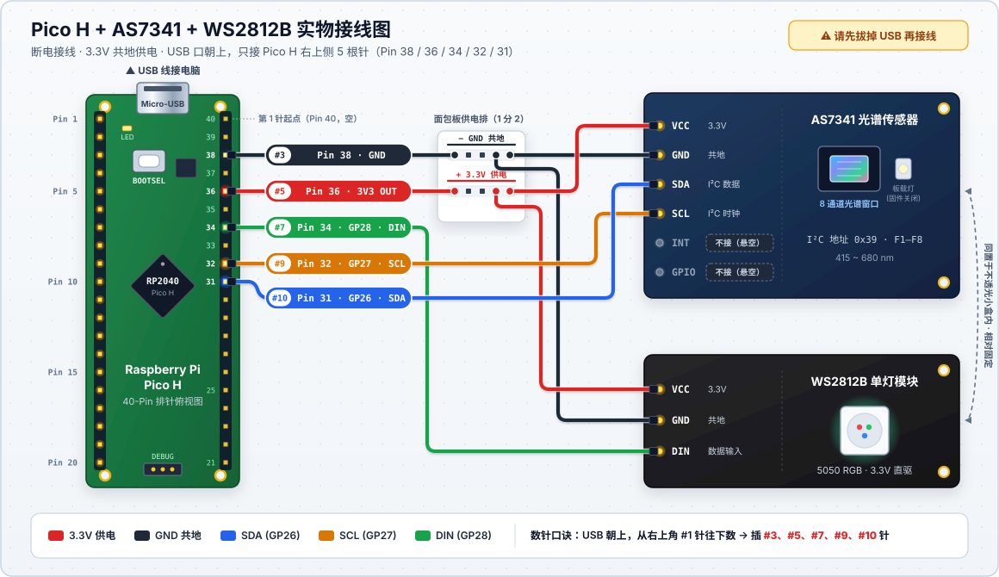
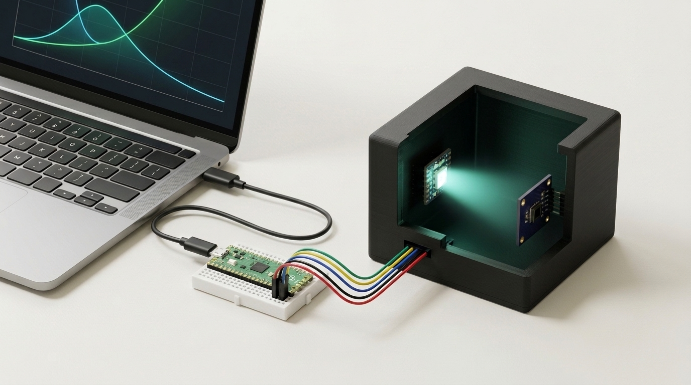

# 开发者与 CLI 技术参考

本文档面向助教、教师维护与进阶开发者，涵盖命令行闭环（`pocket_sdl`）、硬件协议、校准指标、日志恢复与单元测试。普通课堂学生请直接阅读 [使用说明](学生使用说明.md) 与 [课堂操作卡](任务操作卡.md)。

---

## 1. 核心设计原则

基于 **Raspberry Pi Pico H (RP2040) + AS7341 光谱传感器 + WS2812B 单灯模块**。电脑负责 GP-EI / 随机候选与审计日志，Pico 负责 LED 执行和 AS7341 采样，二者通过独立 USB CDC data 串口交换逐行 JSON，无需网络或 LLM API。

- 1331 个 `[0, 0.1, …, 1]³` 候选，LED 上限 80。
- 暗场、亮参考、目标分别独立采样，8 通道 `F1–F8 = [415, 445, 480, 515, 555, 590, 630, 680] nm`。
- 随机搜索与固定超参数 GP-EI，默认 24 次有效观测（课程工作台可按轮次设 12/16/20/24）；前四候选相同。
- 失败立即停止，不补零、不静默重试、不覆盖故障目录。
- 每个最佳点独立确认，输出均值和样本标准差，不占用优化预算。
- `SIMULATED` 只验证软件流程；`PHYSICAL` 才是实际硬件观测，二者不能混用。

## 2. 引脚接线与桌面搭建

**断电接线。** 实物三芯/六芯配套线细节以 [实物接线说明](接线说明.md) 为准。两个模块均由 Pico H 的 `3V3 OUT` 供电并共地，USB 口朝上时连接右侧 5 根针（从右上角 Pin 40 往下数第 **3、5、7、9、10** 针）：



| 模块 | 模块引脚 | Pico H | 说明 |
| --- | --- | --- | --- |
| AS7341 | VCC | pin 36, 3V3 OUT | 3.3V 供电（与 WS2812B 经面包板共排） |
| AS7341 | GND | pin 38, GND | 共地 |
| AS7341 | SDA | pin 31, GP26 | I²C1 SDA，100kHz，地址 `0x39` |
| AS7341 | SCL | pin 32, GP27 | I²C1 SCL |
| AS7341 | INT/GPIO | 不接（悬空） | 仅用于硬件中断/外部同步触发，本方案不使用 |
| WS2812B | VCC | pin 36, 3V3 OUT | 3.3V 供电 |
| WS2812B | GND | Pico GND | 与 AS7341 共地 |
| WS2812B | DIN | pin 34, GP28 | 数据输入直连 |

将 LED 与传感器正对固定在不透光小盒内，实验期间保持距离、朝向和遮光不变：



## 3. 配置与质量门指标

默认配置文件：`configs/physical.json`。

| 参数 | 默认值 |
| --- | --- |
| AS7341 | 地址 `0x39`，`atime=100`，`astep=999`，`GAIN_16X` |
| 单次积分时间 | `(100+1) × (999+1) × 2.78 µs ≈ 281 ms`（完整 F1–F8 含双 SMUX bank 采样） |
| LED | 每通道 0–80，映射 `round(80 × x)` |
| LED 稳定等待 | 50 ms |
| 默认目标 RGB 输入 | `[0.3, 0.6, 0.4]`，对应 `[24, 48, 32]` |
| 暗场 / 参考 / 目标 | 各 3 次完整 F1–F8 读数 |
| 稳定性复测 | 目标点额外 5 次 |
| raw 防护线 | 所有通道 `< 60000` |
| 优化 | `seed=7`，4 次随机初始化，24 次有效观测 |
| BO | RBF `length_scale=0.35`，`noise=0.0025`，`xi=0.01` |

暗场均值 `d`、参考均值 `w`、`A = ||w - d||₂`，观测 `z = (raw - d) / A`，目标 `z* = (target_raw - d) / A`：

```text
L(x) = ||z(x) - z*||₂
```

不逐次归一化光谱，保留亮度差；loss 是无量纲谱差，不是绝对光谱定标或色度 ΔE。`prepare` 强制通过以下质量门：

- `A >= 10 × max(||暗场各通道样本标准差||₂, 1)`；
- 暗场、参考、目标、复测每个 raw 都 `< 60000`；
- 对五次扣暗向量 `zᵢ`，`sqrt(mean(||zᵢ - z̄||₂²)) / max(||z̄||₂, 1e-12) < 0.05`。

饱和或质量门失败时，先检查遮光、固定位置、接线或调整配置中的曝光/增益，不自动放宽阈值。**任何配置或光学位置改变后，必须新建校准，并让两种策略共用同一校准。**

## 4. Pico 固件部署

在 [firmware/README.md](../firmware/README.md) 查看完整刷机、库安装与部署说明。核心是将 `firmware/boot.py` 和 `firmware/code.py` 复制到 `CIRCUITPY`，同时安装匹配 CircuitPython 主版本的 Adafruit AS7341 / NeoPixel 库。本方案使用 **CircuitPython**（非 MicroPython）。

## 5. 开发环境安装与无硬件仿真

支持 Python 3.10+（推荐 Python 3.12）。macOS / Linux 在仓库根目录执行：

```bash
python3.12 -m venv .venv
.venv/bin/python -m pip install -e .
.venv/bin/python -m unittest discover -s tests -v
.venv/bin/python -m pocket_sdl list-ports
```

Windows PowerShell：

```powershell
py -3.12 -m venv .venv
.venv\Scripts\python.exe -m pip install -e .
.venv\Scripts\python.exe -m unittest discover -s tests -v
.venv\Scripts\python.exe -m pocket_sdl list-ports
```

无硬件完整 CLI 仿真流程：

```bash
.venv/bin/python -m pocket_sdl prepare \
  --config configs/simulated.json \
  --out artifacts/sim-cal-001

.venv/bin/python -m pocket_sdl run \
  --calibration artifacts/sim-cal-001/calibration.json \
  --strategy random \
  --out artifacts/sim-random-001

.venv/bin/python -m pocket_sdl run \
  --calibration artifacts/sim-cal-001/calibration.json \
  --strategy bo \
  --out artifacts/sim-bo-001

.venv/bin/python -m pocket_sdl confirm \
  --run artifacts/sim-random-001 \
  --out artifacts/sim-random-confirm-001

.venv/bin/python -m pocket_sdl confirm \
  --run artifacts/sim-bo-001 \
  --out artifacts/sim-bo-confirm-001
```

模拟设备使用简化 RGB→通道线性响应、暗场和固定 seed 高斯噪声；其数据只用于软件测试。`SIMULATED` 模式禁止 `--port`。

## 6. 真机 CLI 闭环

`list-ports` 输出 `device`、`description`、`hwid`、VID/PID 与 `serial_number`。Pico 启用 CDC data 后通常出现两个串口，选择 **data 接口**（通常编号较高），不要选 REPL console。将下方 `usbmodemXXXX` 替换为实际串口（Windows 为 `COMn`）：

```bash
.venv/bin/python -m pocket_sdl doctor \
  --config configs/physical.json \
  --port /dev/cu.usbmodemXXXX

# 红/绿/蓝/白单灯与暗场快速自检
.venv/bin/python scripts/rgb_test.py --port /dev/cu.usbmodemXXXX

.venv/bin/python -m pocket_sdl prepare \
  --config configs/physical.json \
  --port /dev/cu.usbmodemXXXX \
  --out artifacts/cal-001
```

核对校准输出的 `reference_scale`、`dark_noise`、`stability_rms_relative` 后，让 Random 与 BO 共用同一校准执行 `run` 与 `confirm`：

```bash
.venv/bin/python -m pocket_sdl run --calibration artifacts/cal-001/calibration.json --strategy random --port /dev/cu.usbmodemXXXX --out artifacts/random-001
.venv/bin/python -m pocket_sdl run --calibration artifacts/cal-001/calibration.json --strategy bo     --port /dev/cu.usbmodemXXXX --out artifacts/bo-001
.venv/bin/python -m pocket_sdl confirm --run artifacts/random-001 --port /dev/cu.usbmodemXXXX --out artifacts/random-confirm-001
.venv/bin/python -m pocket_sdl confirm --run artifacts/bo-001     --port /dev/cu.usbmodemXXXX --out artifacts/bo-confirm-001
```

## 7. 日志结构与常见故障

CLI 所有 `--out` 必须是不存在的新叶目录（`artifacts/` 默认被 Git 忽略），不覆盖、不静默续跑：

```text
calibration-dir/  status.json · calibration.json · attempts.jsonl · summary.json
run-dir/          status.json · calibration.json · measurements.jsonl · attempts.jsonl · trials.csv · summary.json
confirm-dir/      status.json · confirmations.jsonl · attempts.jsonl · summary.json
```

| 错误 | 处理方式 |
| --- | --- |
| `SERIAL_IO` / `SERIAL_TIMEOUT` | 关闭串口助手/REPL 占用，核对 data 端口、USB 数据线与复位状态 |
| `SENSOR_IO` | 断电检查 `0x39`、SDA/SCL、VCC/GND，再重新 `doctor` |
| `No pull up found on SDA or SCL` | 检查 AS7341 供电、共地及 GP26→SDA、GP27→SCL 是否松动或反接 |
| `SATURATED` | 调整光学几何/曝光/增益/亮度上限，新目录重新校准 |
| `QUALITY_GATE_FAILED` | 检查固定距离、遮光、供电与热漂移，不先换算法 |
| `CONFIG_MISMATCH` | 重新部署固件并核对积分、增益、通道和 LED 参数 |
| `NUMERICAL_ERROR` | 保留故障日志，检查输入与固定 GP 参数，不静默加 jitter |

发生错误或 Ctrl-C 时电脑尽力发送 `off` 并关闭串口；LED 非零且 5 秒无有效命令会触发固件看门狗自动关灯。

## 8. 自动化测试与上层集成

- 单元测试与无硬件全链路测试：`.venv/bin/python -m unittest discover -s tests -v`
- 前端课程页任务五/六逻辑测试：`node tests/test_reliability_ui.cjs`
- 现场互动台与 Jupyter Notebook：见 [workshop/README.md](../workshop/README.md)
- UniLabOS.app 1.1 设备包工作区：见 [integrations/unilab/README.md](../integrations/unilab/README.md)

## 9. 来源与致谢

本仓库基于 [ZiWei09/pocket-sdl](https://github.com/ZiWei09/pocket-sdl)（基线提交 `90012ec9546544a1bdbb83a409fbd7a15f88d8cd`）独立扩展为课程版，保留原 MIT 许可证、固件协议与硬件安全保护。参考资料：

- [Adafruit AS7341 CircuitPython 驱动](https://github.com/adafruit/Adafruit_CircuitPython_AS7341)
- [CircuitPython Pico 固件下载](https://circuitpython.org/board/raspberry_pi_pico/)
- [CircuitPython USB CDC 说明](https://docs.circuitpython.org/projects/circuitpython/en/latest/docs/essentials/usb.html)
