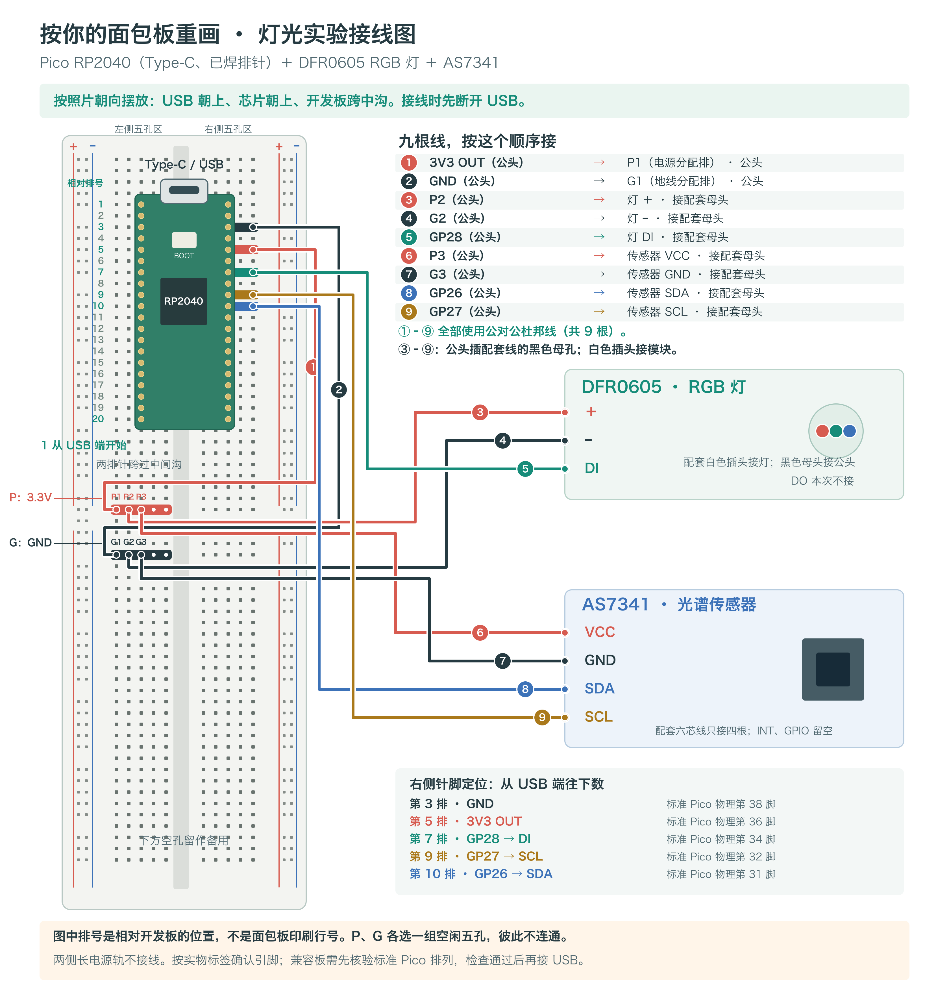
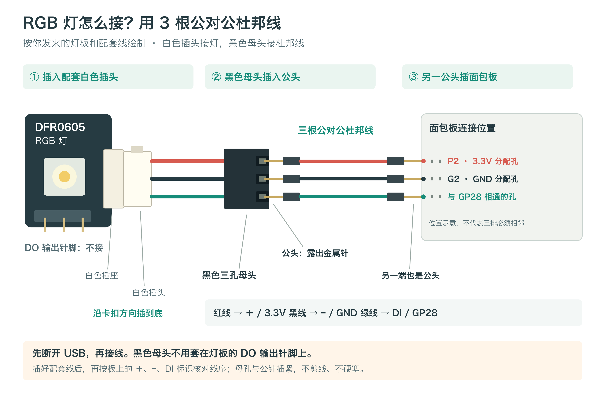
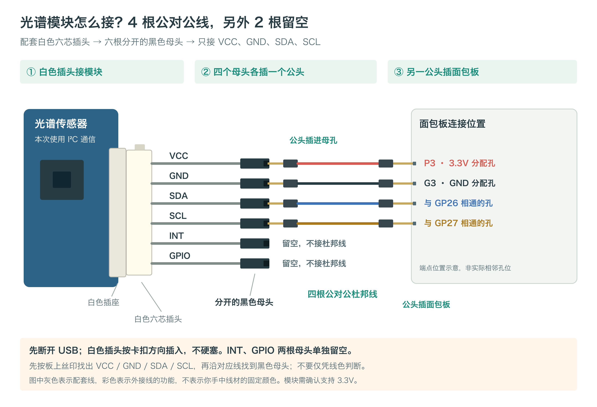

# 最新实物接线说明

依据“workshop试跑”聊天中已确认的 Type-C RP2040 Pico、灯板三芯配套线和AS7341六芯配套线更新。固件信号脚未改变。

断开USB；开发板跨中沟、USB朝上。标准Pico兼容引脚右侧从USB端向下第3/5/7/9/10针分别是GND / 3V3 OUT / GP28 / GP27 / GP26，必须再核对实物丝印，不能只按面包板数字。

中央孔区每一侧每排5孔相通；选两排互不连通空孔，分别作P和G。P1/P2/P3、G1/G2/G3是图中定位标签，不是元件或印刷孔号，不依赖侧面长电源轨是否断开。

| 线号 | 起点 | 终点 |
|---|---|---|
| 1 | Pico 3V3 OUT（物理36脚） | P1 |
| 2 | Pico GND（物理38脚） | G1 |
| 3 | P2 | 灯＋ |
| 4 | G2 | 灯－ |
| 5 | GP28（物理34脚） | 灯DI输入 |
| 6 | P3 | AS7341 VCC |
| 7 | G3 | AS7341 GND |
| 8 | GP26（物理31脚） | AS7341 SDA |
| 9 | GP27（物理32脚） | AS7341 SCL |

九根均为公对公：模块白色插头使用配套线，黑色母头插公头，另一头插面包板。灯DO输出端不接，AS7341的INT/GPIO留空。按丝印验证线序，不只看红黑绿线色。

本次已试跑接法由3.3V给两个模块供电；不可自行把5V送入Pico GPIO。灯和传感器正面对准并固定，线不穿过光路。遮光盒卡扣结构仍属于另一聊天的设计工作，本包不声称已完成/验证最新免螺丝打印结构。

